# Halo3DS — New 2DS performance fork

Halo3DS brings the original Xbox release of *Halo: Combat Evolved* to the Nintendo 3DS and 2DS family. This fork focuses on making the campaign run better on the New 2DS XL while keeping the game's look and timing.

[Screenshots from all ten campaign missions](#campaign-screenshots)

## 343 Guilty Spark

  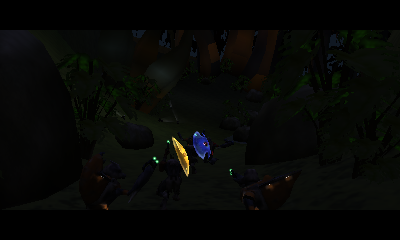
  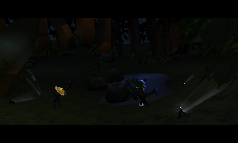

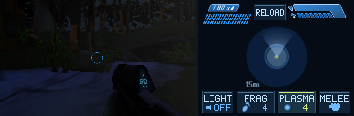

Captured at native screen resolution in Azahar's New 3DS mode.

## What's new in this fork

- **Custom controls.** Choose a preset or remap the face buttons, shoulders and D-pad. New and original systems save their layouts separately, and gameplay prompts follow your bindings. Adjust touch and C-stick sensitivity and inversion independently, and tune the C-stick dead zone.
- **Touch shortcuts.** Tap **RELOAD** at the top or double-tap the aiming area to jump. Along the bottom, tap **LIGHT** to toggle the flashlight, **FRAG** or **PLASMA** to select a grenade, and **MELEE** to attack. The shortcuts work with touch drag aiming turned off on New models.
- **Graphics options.** Choose **Auto**, **Native** (400×240), **Balanced** (320×192), **Performance** (280×168), or **Lowest** (200×120). Smaller world views reduce the number of pixels the GPU draws. The HUD and menus stay sharp. On New models, a separate **Texture Detail** setting controls world detail textures and applies on the next map load.
- **Less work per frame.** The renderer reuses geometry, textures, lighting and material state, skips hidden terrain, and groups compatible draws. Removing unused bottom-screen depth storage frees **300 KiB** of video memory. Animation, AI and pathfinding also reuse calculations where their inputs match.
- **Less work during saves and streaming.** Checkpoints use faster checksums and can keep snapshots in RAM for quick reverts. Persistent saves can compress in the background, and map reads use a separate lock. Audio can prepare samples ahead of use on New models.
- **Gameplay and visual fixes.** Corrected sky animation selection, decal reconnection during area changes, particle impacts and menu input order.

Regular builds run gameplay at **30 Hz**. The optional **60 Hz presentation** build draws in-between frames on New 2DS XL while gameplay stays at 30 Hz. Sustained 60 FPS still needs hardware validation. See the [performance review](docs/PERFORMANCE-GOAL-REVIEW.md) for the full change history and console measurements.

## Install or update

You need a modded 3DS or 2DS, a FAT32 SD card with at least 4 GB free, and your own English North American retail **Xbox Halo CE 1.0** dump. Setup accepts ISO/XISO or extracted maps with the matching `default.xbe`. PC and MCC data are unsupported.

1. Prepare the SD card with the [cross-platform setup CLI](docs/SETUP-CLI.md) or the Windows setup tool from the [upstream Halo3DS releases](https://github.com/Generalkidd/Halo3DS/releases).
2. Use a [launcher built from this fork](docs/DEVELOPMENT.md#building-the-game) to get the changes above. On a prepared card, select the new 3DSX in setup and choose **Update the launcher only**, or replace `3ds/Halo3DS/Halo3DS.3dsx` directly. The launcher update keeps your maps and saves.
3. Eject the card and launch Halo3DS from Homebrew Launcher. If setup asks for sound firmware, open Rosalina with **L + D-pad Down + SELECT**, then choose **Miscellaneous options → Dump DSP firmware**.

## In game

Press **SELECT** for **Controller Settings** or **Y** for **Graphics Options** from the main or pause menu. By default, **L** fires. **ZL** throws grenades on New models, and **R** throws them on original models.

## Campaign screenshots

Captured at native 400×240 resolution in Azahar's New 3DS mode.

<table>
  <tr>
    <td width="50%">
      <strong>1. The Pillar of Autumn</strong> 
      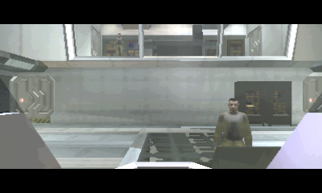
    </td>
    <td width="50%">
      <strong>2. Halo</strong> 
      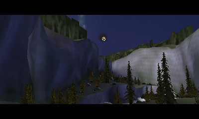
    </td>
  </tr>
  <tr>
    <td width="50%">
      <strong>3. The Truth and Reconciliation</strong> 
      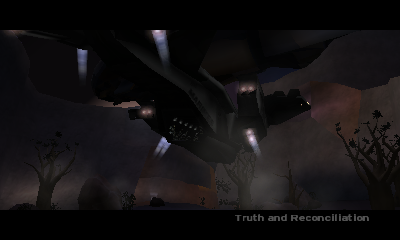
    </td>
    <td width="50%">
      <strong>4. The Silent Cartographer</strong> 
      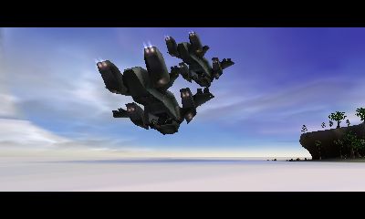
    </td>
  </tr>
  <tr>
    <td width="50%">
      <strong>5. Assault on the Control Room</strong> 
      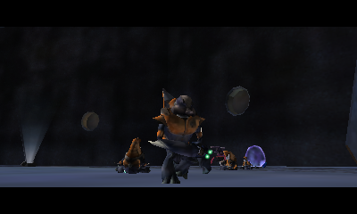
    </td>
    <td width="50%">
      <strong>6. 343 Guilty Spark</strong> 
      
    </td>
  </tr>
  <tr>
    <td width="50%">
      <strong>7. The Library</strong> 
      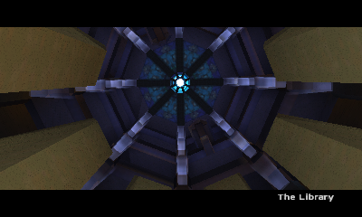
    </td>
    <td width="50%">
      <strong>8. Two Betrayals</strong> 
      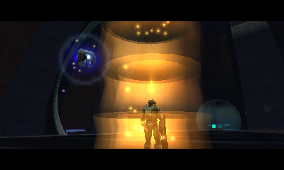
    </td>
  </tr>
  <tr>
    <td width="50%">
      <strong>9. Keyes</strong> 
      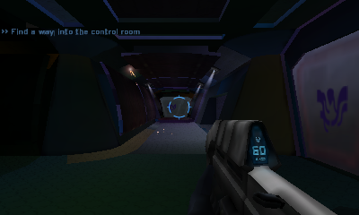
    </td>
    <td width="50%">
      <strong>10. The Maw</strong> 
      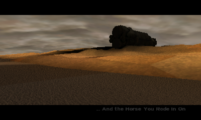
    </td>
  </tr>
</table>

## Benchmark and report issues

The [A30 benchmark](docs/DEVELOPMENT.md#new-2ds-xl-performance-comparisons) locks the world to 400×240 and records CPU, GPU and checkpoint timings through the dropship and Marines encounter. Send `halo-a30-benchmark.log` from the SD root with your console model, build, difficulty and where the slowdown happened. For regular gameplay, collect `halo-source-engine.log` before relaunching, plus any fatal or stall log and Luma crash dump.

The [developer notes](docs/DEVELOPMENT.md) cover builds, optional texture archives, GPU probes, tracing and replay tests.

## Credits and licenses

This fork builds on [Halo3DS](https://github.com/Generalkidd/Halo3DS) and the [OpenCE source](https://github.com/bnunu/halo-1) at revision `8d0c1ff46ef92511e4809fff422bacd94c3b7c67`. See [LICENSE.md](LICENSE.md), the [setup notices](port/n3ds/setup/THIRD-PARTY.md), and the [LZ4](port/n3ds/vendor/lz4/LICENSE) and [allocator](port/n3ds/vendor/libctru-allocator/LICENSE.txt) licenses. Game assets, Xbox SDK files and Nintendo DSP firmware are supplied separately.
