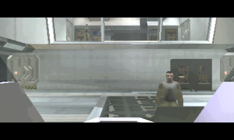
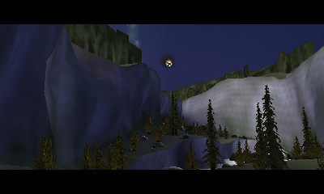
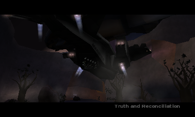
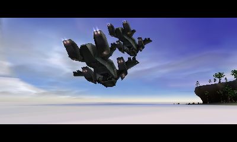
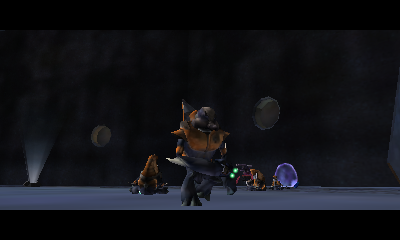
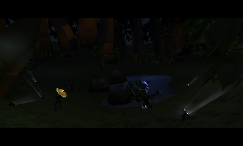
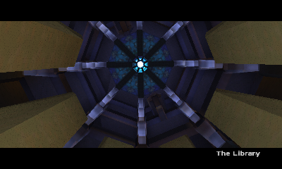
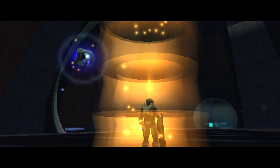
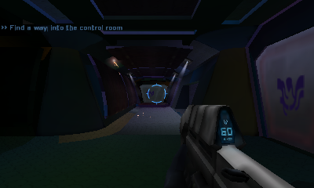
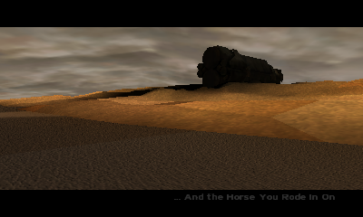

# Campaign screenshots

Scenes from all ten *Halo: Combat Evolved* campaign missions, captured at native 400×240 resolution in Azahar's New 3DS mode.

## 1. The Pillar of Autumn

## 2. Halo

## 3. The Truth and Reconciliation

## 4. The Silent Cartographer

## 5. Assault on the Control Room

## 6. 343 Guilty Spark

## 7. The Library

## 8. Two Betrayals

## 9. Keyes

## 10. The Maw

